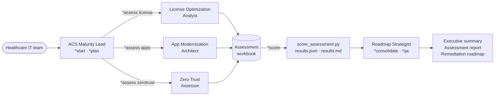

# 🏥 ACS Health Maturity Kit v0.1.0

**A free, open toolkit that helps U.S. healthcare organizations assess and improve three things that decide whether their technology is secure, reliable and affordable: software licensing, application modernization and Zero Trust security.**

Answer 76 questions in an Excel workbook, or let an AI assistant guide you through them. You get a scored maturity profile, your status against all 20 HHS Cybersecurity Performance Goals, a ranked list of gaps and a remediation roadmap your own team can execute.


Created by Eric Gomes de Andrade (Andrade Consulting Services).

---

## 📑 Contents

- [Why this exists](#-why-this-exists)
- [Who it is for](#-who-it-is-for)
- [Quick start](#-quick-start)
- [What's inside](#-whats-inside)
- [The three services assessed](#-the-three-services-assessed)
- [How scoring works](#-how-scoring-works)
- [HHS Cybersecurity Performance Goals coverage](#-hhs-cybersecurity-performance-goals-coverage)
- [Workbook tour](#-workbook-tour)
- [AI agent layer](#-ai-agent-layer)
- [A one-week assessment plan](#-a-one-week-assessment-plan)
- [Repository structure](#-repository-structure)
- [Privacy and safety](#-privacy-and-safety)
- [FAQ](#-faq)
- [Tell us how you used it](#-tell-us-how-you-used-it)
- [Contributing](#-contributing)
- [Related open-source projects](#-related-open-source-projects)
- [Roadmap](#-roadmap)
- [Disclaimer](#-disclaimer)
- [License and citation](#-license-and-citation)
- [Sources](#-sources)

---

## 💡 Why this exists

Healthcare organizations are connected through vendors, clearinghouses, payers and data exchanges, so a weakness in one organization can disrupt care far beyond it. The 2024 ransomware attack on Change Healthcare disrupted payments, insurance verification and prior authorizations for providers across the country. Large breaches of health information reported to HHS affected more than 289 million individuals in 2024.

HHS has published Cybersecurity Performance Goals for the sector, and many organizations—especially rural, community and independent hospitals with small IT teams—need a practical way to know where they stand, what to fix first, and how to use the licenses and tools they already pay for.

Three problems tend to show up together:

| Problem | What it looks like | What the kit helps you do |
|---|---|---|
| **Paying for security you have not turned on** | Licenses include MFA, conditional access, device management or email protection that was never deployed | Map licensed capabilities to deployment status and to the HHS goal each one supports |
| **Running critical systems on unsupported platforms** | Clinical and business applications depend on operating systems or software that no longer receive security updates | Inventory applications, score technical risk and get a suggested disposition for each |
| **No baseline to plan from** | Security and modernization investments are decided without a shared, evidence-based view of current maturity | Score 76 practices, rank the gaps and turn them into a 0–90 day, 3–6 month and 6–18 month roadmap |

This kit gives them that, for free, in a form they can use without hiring anyone.

---

## 👥 Who it is for

| Audience | How they use it |
|---|---|
| **IT leaders at rural, community and independent hospitals** | Run a self-assessment in about one week of part-time effort and get a prioritized plan |
| **Clinics, physician groups and other healthcare providers** | Use the same questions to establish a baseline against the HHS goals |
| **CIOs, CFOs and boards** | Read the one-page executive summary and the HHS goal status |
| **Security, infrastructure and applications teams** | Use the evidence checklist, App Portfolio Triage and modernization runbook template |
| **Consultants, MSPs and state or regional support programs** | Run the assessment with the organizations they support, using the AI agents or the workbook |

---

## 🚀 Quick start

### Option A — Workbook only (no technical skills needed)

1. Download [`toolkit/ACS-Health-Maturity-Assessment.xlsx`](toolkit/ACS-Health-Maturity-Assessment.xlsx) (or the copy attached to the latest [release](../../releases)).
2. Open it in Microsoft Excel or LibreOffice Calc and read the **Start Here** sheet.
3. Fill the **Profile** sheet, then answer the yellow cells in the three service sheets.
4. Review **Dashboard**, **Priority Gaps** and **CPG Crosswalk**. They update automatically.

### Option B — Workbook plus AI agents

```bash
git clone https://github.com/ericgandrade/acs-health-maturity-kit
cd acs-health-maturity-kit
claude            # or open the folder in another AI assistant that can read files
```

Then, inside Claude Code:

```text
/acs-assess
```

Follow the commands: `*start` → `*assess license` → `*assess apps` → `*assess zerotrust` → `*score <file.xlsx>` → `*consolidate`.

Using ChatGPT, Copilot, Gemini or another assistant? See [Using the agents with other assistants](#using-the-agents-with-other-assistants).

### Option C — Score from the command line

```bash
pip install -r requirements.txt
python tools/score_assessment.py my-assessment.xlsx results
# writes results.json and results.md
```

---

## 📦 What's inside

| Component | Location | What it does |
|---|---|---|
| **Assessment workbook** | `toolkit/ACS-Health-Maturity-Assessment.xlsx` | 76 maturity questions across three services, with automatic scoring, dashboard, priority gaps and HHS goal crosswalk |
| **App Portfolio Triage** | sheet in the workbook | Inventory applications, score technical risk and get a suggested disposition |
| **License-Security Map** | sheet in the workbook and `data/license_security_map.csv` | See which security capabilities common Microsoft licenses include and whether you have deployed them |
| **AI agent layer** | `agents/`, `workflows/`, `templates/`, `checklists/` | A lightweight, file-based method to run the assessment with an AI assistant |
| **Runbook and report templates** | `templates/` | Modernization runbook with test and rollback steps; assessment report, executive summary and remediation roadmap |
| **Scoring tool** | `tools/score_assessment.py` | Turns a completed workbook into JSON and Markdown results |
| **Workbook builder** | `tools/build_workbook.py` | Rebuilds the workbook from the question bank |
| **Question bank** | `data/questionnaire.csv` | The single source of truth for all questions and framework mappings |
| **Documentation** | `docs/` | Methodology, framework mapping and a step-by-step guide |

---

## 🧭 The three services assessed

| Service | Questions | Dimensions |
|---|---|---|
| **License Optimization** | 24 | Governance & Ownership · Entitlements · Deployment & Usage · Security Value Realization · Cloud Cost · Programs & Negotiation |
| **App Modernization** | 24 | Portfolio Visibility · Lifecycle & Supportability · Rationalization & Roadmap · Engineering & Release · Resilience & Recovery · Cloud & Data Readiness |
| **Zero Trust** | 28 | Identity · Devices · Networks · Applications & Workloads · Data · Visibility & Analytics · Governance & Readiness |

Every question has a description of what "optimized" looks like, the evidence to review, a recommended action, and references to the **HHS Healthcare and Public Health Cybersecurity Performance Goals**, the **HIPAA Security Rule**, **NIST CSF 2.0**, the **CISA Zero Trust Maturity Model v2.0**, **NIST SP 800-218 (SSDF)**, **ISO/IEC 19770-1** and the **FinOps Framework**. Modernization planning questions also reference the **Microsoft Cloud Adoption Framework**. The full mapping is in [`docs/framework-mapping.md`](docs/framework-mapping.md).

---

## 📊 How scoring works

### Maturity scale

| Answer | Meaning |
|---|---|
| **0 – Not in place** | The practice does not exist. |
| **1 – Initial** | Ad hoc; depends on individuals; not documented. |
| **2 – Developing** | Partly implemented or documented; not applied consistently. |
| **3 – Defined** | Documented and applied consistently across the organization. |
| **4 – Optimized** | Measured, reviewed regularly and improved; automated where practical. |
| **N/A** | The practice does not apply (explain why in Notes). |

Answers reflect what is in place today, supported by evidence. Plans count as 0–2 depending on how much is already implemented.

### Weights

- **3** — critical to patient safety, continuity of care or protection of PHI (for example MFA, backups, unsupported platforms).
- **2** — important to control and efficiency.
- **1** — foundational practices that enable the others.

### Calculations

| Result | How it is calculated |
|---|---|
| Question score | 0–4 |
| Dimension, service and overall score | Weighted average of answered questions (N/A and blanks excluded) |
| Level | Integer part of the score (for example 2.6 → Developing) |
| Gap points | (4 − score) × weight; used to rank the Priority Gaps |
| HHS goal status | Average of the questions mapped to the goal: 3 or more = **Meets**, 2 to 2.99 = **Partially meets**, below 2 = **Gap** |

The workbook and `tools/score_assessment.py` apply the same rules, so the spreadsheet and the command-line results agree. See [`docs/methodology.md`](docs/methodology.md).

---

## 🔐 HHS Cybersecurity Performance Goals coverage

All 20 goals are mapped to at least one question. The **CPG Crosswalk** sheet shows the status of each goal for your organization.

| Type | Goal | Related questions |
|---|---|---|
| Essential | Mitigate Known Vulnerabilities | LO-15, AM-05, ZT-06 |
| Essential | Email Security | LO-13, LO-16, ZT-12 |
| Essential | Multifactor Authentication | LO-13, LO-14, ZT-01 |
| Essential | Basic Cybersecurity Training | ZT-25 |
| Essential | Strong Encryption | LO-13, LO-16, ZT-11, ZT-16 |
| Essential | Revoke Credentials for Departing Workforce Members | LO-11, ZT-04 |
| Essential | Basic Incident Planning and Preparedness | ZT-24 |
| Essential | Unique Credentials | ZT-02 |
| Essential | Separate User and Privileged Accounts | ZT-03 |
| Essential | Vendor/Supplier Cybersecurity Requirements | LO-08, AM-22, ZT-10, ZT-26 |
| Enhanced | Asset Inventory | LO-09, AM-01, ZT-05 |
| Enhanced | Third Party Vulnerability Disclosure | ZT-15 |
| Enhanced | Third Party Incident Reporting | ZT-15 |
| Enhanced | Cybersecurity Testing | ZT-14 |
| Enhanced | Cybersecurity Mitigation | AM-06, ZT-27 |
| Enhanced | Detect and Respond to Relevant Threats and TTPs | ZT-21 |
| Enhanced | Network Segmentation | AM-08, ZT-09 |
| Enhanced | Centralized Log Collection | ZT-20 |
| Enhanced | Centralized Incident Planning and Preparedness | ZT-24 |
| Enhanced | Configuration Management | LO-15, AM-13, ZT-08 |

---

## 📗 Workbook tour

| Sheet | What you do there |
|---|---|
| **Start Here** | Purpose, instructions, scale, weights, privacy rules and legend |
| **Profile** | Organization context: type, state, beds, workforce, IT staff, primary EHR, Microsoft agreement and plan |
| **License Optimization** | 24 questions, answered in the yellow cells |
| **App Modernization** | 24 questions, answered in the yellow cells |
| **Zero Trust** | 28 questions organized by the CISA Zero Trust Maturity Model pillars |
| **Dashboard** | Scores by service and dimension, with charts |
| **Priority Gaps** | The 20 gaps with the most gap points and the recommended action for each |
| **CPG Crosswalk** | Status against each of the 20 HHS Cybersecurity Performance Goals |
| **App Portfolio Triage** | One row per application: technical risk (0–8), priority (0–40) and a suggested disposition, with columns for your final decision, owner and target date |
| **License-Security Map** | Security capabilities included in common Microsoft licenses, the HHS goal each supports and whether you have deployed it |

Only yellow cells are inputs. Everything else is calculated.

---

## 🤖 AI agent layer

The kit includes a lightweight, file-based agent method. Each agent is a plain Markdown file that defines a role, a mission, activation steps, commands and rules, so it works with any AI assistant that can read files. The approach is inspired by the agent-persona pattern popularized by the open-source BMAD Method, simplified for a single purpose.

### Roster

| Agent | File | Responsibility | Key commands |
|---|---|---|---|
| **ACS Maturity Lead** | `agents/acs-maturity-lead.md` | Orchestrates the assessment, hands off to specialists, runs scoring | `*start` `*plan` `*assess <service>` `*score` `*consolidate` `*status` |
| **License Optimization Analyst** | `agents/license-optimization-analyst.md` | LO-01 to LO-24, License-Security Map, quick wins | `*assess` `*challenge` `*quick-wins` `*renewal-check` `*findings` |
| **App Modernization Architect** | `agents/app-modernization-architect.md` | AM-01 to AM-24, App Portfolio Triage, modernization waves | `*inventory` `*assess` `*triage` `*unsupported` `*roadmap-draft` `*findings` |
| **Zero Trust Assessor** | `agents/zero-trust-assessor.md` | ZT-01 to ZT-28, HHS goals, ransomware readiness | `*essentials` `*assess` `*cpg-status` `*ransomware-readiness` `*findings` |
| **Roadmap Strategist** | `agents/roadmap-strategist.md` | Consolidation, prioritization, report, executive summary, roadmap | `*prioritize` `*roadmap` `*report` `*exec-summary` `*qa` |

### How the agents work together



### Workflows, templates and checklists

| Type | Files |
|---|---|
| **Workflows** | `01-intake.md` (30–45 min) · `02-service-assessment.md` (60–90 min per service) · `03-consolidate-and-report.md` |
| **Templates** | `assessment-report.md` · `executive-summary.md` · `remediation-roadmap.md` · `modernization-runbook.md` |
| **Checklists** | `evidence-checklist.md` · `privacy-and-safety.md` · `report-quality-checklist.md` |

Every agent follows the same rules: no PHI, no secrets, evidence over intent, no invented facts, advisory only. A score of 3 or 4 is accepted only when the evidence has been confirmed.

### Using the agents in Claude Code

The repository ships with Claude Code subagents in `.claude/agents/` and the `/acs-assess` command in `.claude/commands/`. Open the folder in Claude Code and run `/acs-assess`, or call a specialist subagent directly.

### Using the agents with other assistants

For ChatGPT, GitHub Copilot, Gemini and others: paste the content of `checklists/privacy-and-safety.md` followed by the agent file as the first message or system instructions, then attach or paste the questions for the service from `data/questionnaire.csv`. Do not upload the workbook to tools your organization has not approved.

See [`agents/README.md`](agents/README.md) for details.

---

## 📅 A one-week assessment plan

A small hospital IT team can complete the assessment in about one week of part-time effort.

| Day | Activity | Who |
|---|---|---|
| 1 | Read *Start Here*, fill the Profile sheet, agree participants and evidence | IT leader |
| 2 | License Optimization session; complete the License-Security Map | IT leader, procurement or finance |
| 3 | App Modernization session; start the App Portfolio Triage | Applications and infrastructure leads, clinical informatics |
| 4 | Zero Trust session; review the CPG Crosswalk | Security lead, compliance or privacy officer |
| 5 | Score, prioritize and draft the roadmap | IT leader with leadership review |

Re-assess every 6–12 months with the same workbook to measure progress. See [`docs/how-to-run-an-assessment.md`](docs/how-to-run-an-assessment.md).

---

## 📁 Repository structure

```
acs-health-maturity-kit/
├── toolkit/        the Excel workbook used by the organization
├── data/           questions and reference data (single source of truth)
├── agents/         who does the work (roles, commands, rules)
├── workflows/      how the work is done, step by step
├── templates/      what the outputs look like
├── checklists/     how quality, evidence, privacy and safety are checked
├── docs/           methodology, framework mapping, how-to guide
├── tools/          build the workbook, score a completed assessment
├── integrations/   source of the Claude Code and GitHub integration files
├── .claude/        Claude Code subagents and the /acs-assess command
└── .github/        issue forms: Adoption report and Feedback
```

**Maintainers:** the files in `.claude/` and `.github/` are copies of `integrations/`. After editing `integrations/`, run `bash tools/install_integrations.sh` to refresh them. After editing `data/questionnaire.csv`, rebuild the workbook with `python tools/build_workbook.py`.

---

## 🔒 Privacy and safety

- Do **not** enter protected health information (PHI), passwords, keys or network addresses in the workbook or in any AI conversation. The kit never needs them.
- Evidence can be shown on screen during a session; it does not need to be copied into the workbook.
- Completed assessments are excluded by `.gitignore` (`assessments/`, `results*.json`, `results*.md`). Never commit them to a public repository.
- The agents are advisory. Decisions stay with the organization's accountable owners.

See [`checklists/privacy-and-safety.md`](checklists/privacy-and-safety.md).

---

## ❓ FAQ

**Is it really free?**
Yes. The content is licensed CC BY 4.0 and the code MIT. You can use, adapt and share it, including commercially, with attribution.

**Do I need Microsoft licenses to use it?**
No. The maturity questions apply to any technology stack. Only the License-Security Map is specific to common Microsoft licensing, because many healthcare organizations already pay for it.

**Do I need an AI assistant?**
No. The workbook works on its own in Excel or LibreOffice Calc. The agents are an optional way to guide the conversation and draft the reports.

**Does a good score mean we are HIPAA compliant?**
No. The kit is a self-assessment aid. Framework mappings are the author's interpretation, and meeting a mapped question does not establish compliance with any framework or regulation.

**How long does it take?**
About one week of part-time effort for a small hospital IT team: one intake, one 60–90 minute session per service and one consolidation session.

**Can a consultant or MSP use it with clients?**
Yes, under CC BY 4.0. Please keep the attribution and the privacy rules.

**How current is the licensing information?**
Licensing contents change frequently. Verify every statement in the License-Security Map against current Microsoft documentation and your agreement.

**Can I add questions or a new service?**
Yes. Add questions to `data/questionnaire.csv`, add or update an agent, a workflow and a template, rebuild the workbook and update `CHANGELOG.md`. See [`agents/README.md`](agents/README.md#extending-the-method) and [CONTRIBUTING.md](CONTRIBUTING.md).

---

## 📣 Tell us how you used it

If your organization used the kit, please open an [Adoption report](../../issues/new?template=adoption-report.yml). It takes two minutes, you choose whether your organization is named, and it tells us what to improve. Organizations that agree to be listed appear in [ADOPTERS.md](ADOPTERS.md).

Found an error or have a suggestion? Open a [Feedback](../../issues/new?template=feedback.yml) issue.

---

## 🤝 Contributing

Contributions are welcome: adoption reports, corrections, new questions and pull requests. Questions live only in `data/questionnaire.csv`, licensing statements must cite current Microsoft documentation, and no contribution may include PHI, credentials or details of any organization's environment. See [CONTRIBUTING.md](CONTRIBUTING.md).

---

## 🧩 Related open-source projects

Other open-source work by the same author, useful for teams that build with AI assistants:

| Repository | What it is |
|---|---|
| [claude-superskills](https://github.com/ericgandrade/claude-superskills) | Universal AI skills for planning, research, orchestration and content, for Claude Code, GitHub Copilot and other platforms |
| [product-superskills](https://github.com/ericgandrade/product-superskills) | AI skills for product management, strategy and go-to-market |
| [design-superskills](https://github.com/ericgandrade/design-superskills) | AI skills for UI/UX design, design systems, diagrams and presentations |
| [obsidian-superskills](https://github.com/ericgandrade/obsidian-superskills) | AI skills for knowledge management in Obsidian |

---

## 📈 Roadmap

New methods are published here as they are developed. Each new method follows the same pattern: questions in `data/`, an agent, a workflow and a template. See [CHANGELOG.md](CHANGELOG.md).

---

## 🚨 Disclaimer

This kit is a self-assessment aid. It is not legal, licensing or compliance advice and does not certify compliance with HIPAA or any other requirement. Framework mappings are the author's interpretation and do not imply endorsement by HHS, NIST, CISA, ISO, the FinOps Foundation or Microsoft. Licensing contents change frequently; verify every licensing statement against current Microsoft documentation and your agreement.

---

## 📜 License and citation

- Workbook, questions, documentation, agents and templates: [CC BY 4.0](LICENSE-CONTENT.md).
- Scripts in `tools/`: [MIT](LICENSE).
- To cite the kit, use the **Cite this repository** button or see [CITATION.cff](CITATION.cff).

---

## 📚 Sources

- Healthcare Dive, "Change Healthcare cyberattack affects 190M people, UnitedHealth says," January 27, 2025.
- The HIPAA Journal, "2025 Healthcare Data Breach Report" (based on HHS Office for Civil Rights breach reports).
- U.S. Department of Health and Human Services, [Healthcare and Public Health Cybersecurity Performance Goals](https://hhscyber.hhs.gov/cybersecurity-performance-goals.html).
- CISA, Zero Trust Maturity Model v2.0 (April 2023); NIST, Cybersecurity Framework 2.0 (February 2024); NIST SP 800-218.
